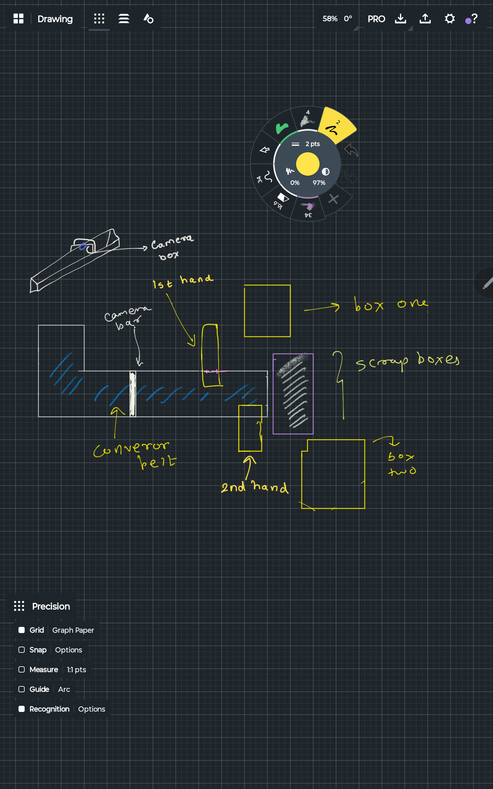

# Conveyor Sorter - ROS 2 Kinematic Simulation 

An autonomous two-arm robotic conveyor sorting system simulated in **ROS 2** and visualized in **RViz2**.


---

## 📐 System Layout & Design

The physical layout and bin placement strictly follows the project design specification:



```
       [Red Bin (box one)]
                ^
             [Arm 1] (Picks RED only)
                |
[Spawn] === [Camera Bar] === [Conveyor Belt +X] === [Scrap Bin]
                                      |
                                   [Arm 2] (Picks BLUE only)
                                      v
                             [Blue Bin (box two)]
```

* **Conveyor Belt**: 3.0 m length, carries randomly generated Red, Blue, and Black boxes along the +X direction.
* **Arm 1 (1st Hand)**: Located on the `+Y` side at `x = 0.8m`. Detects and picks **RED** boxes into the Red Bin (`y = +0.75m`).
* **Arm 2 (2nd Hand)**: Located on the `-Y` side at `x = 1.8m`. Detects and picks **BLUE** boxes into the Blue Bin (`y = -0.75m`).
* **Scrap Bin**: Located at the end of the belt (`x = 3.25m`). **Black** boxes are never picked and ride into scrap by design. Any Red/Blue box missed due to an arm being busy or out of reach falls into scrap and is tallied as **missed**.
* **Zero Error Rate**: Strict exclusive reservation guarantees wrong-bin sorts are impossible ($0$).

---

## 🏗️ Architecture: Nodes & Topics

```
                  +-------------------------+
                  |       box_spawner       |<----------------+
                  +-------------------------+                 |
                     |                   |                    |
        /conveyor/box_spawned   /conveyor/boxes_markers       |
                     |                                        |
                     v                                        |
            +------------------+                              |
            |   color_sensor   |                              |
            +------------------+                              |
                     |                                        |
         /conveyor/color_detection                            |
          |                      |                            |
          v                      v                            |
  +---------------+      +---------------+                    |
  | arm1 (RED)    |      | arm2 (BLUE)   |                    |
  +---------------+      +---------------+                    |
          |       \      /       |                            |
          |    /conveyor/carry --+----------------------------+
          |                      |
          +------> /tf <---------+  (joint states -> robot_state_publisher)
          |                      |
          +-> /conveyor/pick_log +-> +-------------------+
                                     |   stats_display   |
                                     +-------------------+
                                              |
                                   /conveyor/stats_markers (RViz HUD)
```

### Node Summary

| Node | Executable | Role | Key Topics |
|------|------------|------|------------|
| **box_spawner** | `box_spawner` | Generates boxes procedurally, maintains poses, handles gravity drop into bins. | Publishes: `/conveyor/boxes_markers`, `/conveyor/box_spawned`<br>Subscribes: `/conveyor/carry`, `/conveyor/pick_log` |
| **conveyor** | `conveyor` | Drives the belt surface speed and publishes moving belt visual stripes. | Publishes: `/conveyor/belt_markers`, `/conveyor/state` |
| **color_sensor** | `color_sensor` | Dual virtual sensor lines in front of each arm triggered via feed-forward positions. | Publishes: `/conveyor/color_detection`, `/conveyor/sensor_markers` |
| **arm1 / arm2** | `arm_controller` | 8-state machine controlling 3-DOF arm with predictive feed-forward IK. | Publishes: `/<arm>/joint_states`, `/<arm>/state`, `/conveyor/carry`, `/conveyor/pick_log` |
| **stats_display** | `stats_display` | Live RViz 3D HUD text marker overlay and prints final stats report on shutdown. | Publishes: `/conveyor/stats_markers`<br>Subscribes: `/conveyor/pick_log`, `/<arm>/state` |
| **robot_state_publisher** | `robot_state_publisher` | Publishes standard TF transforms from URDF/Xacro model. | Subscribes: `/joint_states` |

---

## 🦾 Arm State Machine & Kinematics

Each arm controller operates an autonomous deterministic state machine:

$$\text{IDLE} \longrightarrow \text{DETECT} \longrightarrow \text{REACH} \longrightarrow \text{GRASP} \longrightarrow \text{LIFT} \longrightarrow \text{MOVE\_TO\_BIN} \longrightarrow \text{RELEASE} \longrightarrow \text{RETURN}$$

1. **Interception with Feed-Forward Tracking**: Because the belt runs continuously, `REACH` uses closed-form analytical inverse kinematics (`kinematics.py`) targeted at:
   $$x_{\text{target}} = x_0 + v_{\text{belt}} \cdot (t_{\text{now}} + \Delta t_{\text{reach}} - t_0)$$
2. **Exclusive Box Claiming**: An arm marks a targeted box as `CLAIMED` on `/conveyor/pick_log` immediately upon commitment, preventing double-targeting or race conditions.
3. **Smooth Trajectory Generation**: Joint movements use cubic smoothstep interpolation:
   $$S(s) = 3s^2 - 2s^3 \quad (s \in [0, 1])$$

---

## 🚀 Build and Run

### 1. Build Workspace

```bash
cd /mnt/c/ros2_ws/P4-conveyor_belt
rm -rf build install log
colcon build
source install/setup.bash
```

*(On native Windows ROS 2 terminal, run `colcon build` from `C:\ros2_ws\P4-conveyor_belt` and call `install\setup.bat`)*

### 2. Launch Full Simulation

```bash
ros2 launch conveyor_sorter sorter.launch.py
```

### Launch Arguments

| Argument | Default | Description |
|----------|---------|-------------|
| `belt_speed` | `0.15` | Conveyor linear speed ($m/s$) |
| `spawn_rate` | `0.5` | Mean box spawn frequency ($boxes/s$) |
| `red_prob` | `0.35` | Probability of generating a RED box |
| `blue_prob` | `0.35` | Probability of generating a BLUE box |
| `black_prob` | `0.30` | Probability of generating a BLACK box |
| `use_rviz` | `true` | Launch RViz2 visualizer |
| `software_render` | `false` | Enable `LIBGL_ALWAYS_SOFTWARE=1` (useful for WSL2 GPU rendering) |
| `params_file` | `sorter_params.yaml` | Path to parameters YAML configuration |

Example with custom speed and spawn rate:
```bash
ros2 launch conveyor_sorter sorter.launch.py belt_speed:=0.20 spawn_rate:=0.8
```

---

## ⚙️ Configuration & Belt Speed Tuning

All parameters are centralized in `src/conveyor_sorter/config/sorter_params.yaml`:

- **Belt Speed Tuning**:
  - The default speed is $0.15\text{ m/s}$.
  - The arm pick sequence takes approximately $1.5\text{ s}$ (`reach + grasp + lift`).
  - To avoid misses, ensure the box travel time across the arm reach envelope ($\approx 0.7\text{ m}$) is greater than or equal to the arm acquisition time:
    $$v_{\text{belt}} \le \frac{\text{Reach Envelope}}{\Delta t_{\text{pick}}} \approx \frac{0.7\text{ m}}{1.5\text{ s}} \approx 0.46\text{ m/s}$$
  - Recommended practical operating speed is between $0.10\text{ m/s}$ and $0.25\text{ m/s}$.

---

## 📊 Live HUD & Shutdown Report

During simulation, RViz displays a live 3D floating statistics HUD above the conveyor. Upon pressing `Ctrl+C`, the system prints a clean summary to console:

```text
============================================================
              CONVEYOR SORTER RUN SUMMARY
============================================================
Duration:               48.2 s
Total Spawned:          24 boxes
  - Red Bin (Arm 1):    9 (37.5%)
  - Blue Bin (Arm 2):   8 (33.3%)
  - Scrap Bin (Total):  7 (29.2%)
      * Black (by design): 6 (25.0%)
      * Missed (Red/Blue): 1 (4.2%)
Wrong Bin Errors:       0 (0.00%)
Sorting Success Rate:   94.4% (of actionable red/blue boxes)
============================================================
```

---

## 🧪 Unit Tests

Run test suite covering closed-form IK/FK roundtrip, reachable workspace boundaries, feedforward math, RViz config validity, and headless simulation logic:

```bash
cd /mnt/c/ros2_ws/P4-conveyor_belt
pytest src/conveyor_sorter/test -v
```
